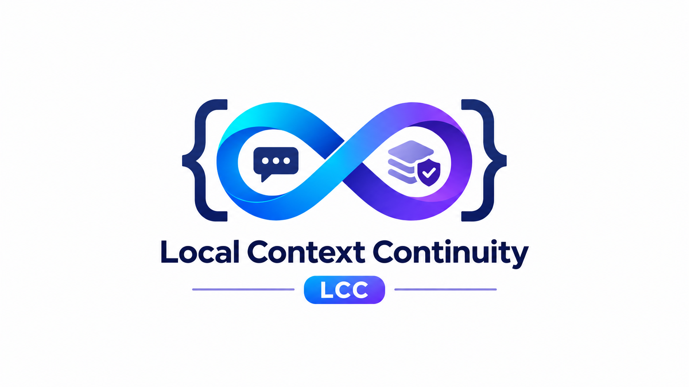

# Local Context Continuity

<p align="center">
  
</p>

Local Context Continuity (LCC) preserves observed task state across process
restarts and builds bounded context packets. The offline alpha reads a
synthetic append-only JSONL source, checkpoints progress in SQLite, and
checks a proposed next action against evidence for the current artifact revision.

## Quickstart

From a source checkout with Python 3.11 or later and standard-library SQLite, run

```sh
python3.11 -B -m lcc.alpha
```

The walkthrough uses temporary synthetic files. A pending operation survives
packet compaction and restart. The decision gate blocks a proposal backed by an
obsolete verification, then allows it once the current revision's passing
receipt is committed. See the [alpha guide](docs/offline-v1-alpha.md) for offline
wheel installation, build instructions, and the release checklist.

## Results and limits

- On the retained comparison set, LCC used **4,787 prompt tokens versus 6,465**
  per deployment, approximately **26% fewer**. Model correctness tied at
  **1/6 per strategy**. [Evaluation methodology](docs/standalone-evaluation.md)
- Offline decision validation **blocked six stale proposals and allowed two
  valid controls** against committed evidence. [Decision replay](docs/decision-validation-prototype.md)
- Production action enforcement and installed OpenClaw integration remain
  unqualified. Packets can contain retained source text and tool payloads.
  Use only inputs approved for the receiver and keep the offline trust
  boundary explicit. [Architecture and security](docs/offline-v1-alpha.md#architecture-and-security)

## Use a synthetic source

Use a dedicated SQLite checkpoint for each source and scope. Recover the
latest committed projection, then build a read-only packet from it and an
explicit caller context.

```sh
python3.11 -B -m lcc recover SOURCE.jsonl CHECKPOINT.sqlite TASK SESSION WORKFLOW
python3.11 -B -m lcc packet SOURCE.jsonl CHECKPOINT.sqlite TASK SESSION WORKFLOW \
  --task-context CONTEXT.json --max-bytes 4096
```

The recovery command prints scoped state, evidence IDs, and an opaque cursor.
The packet command prints accepted packet bytes to standard output and an
admission report to standard error. Rejection leaves standard output empty and
exits with status 1. See the [packet contract](docs/resume-packets.md).

### Fixture format

The first UTF-8 JSONL line is an object with `schema: 1` and `source_id`. Each
event has an `id`, `kind`, `scope`, and `origin`. Use a scope object containing
`task`, `session`, and `workflow`. An optional string `timestamp` supplies
metadata. Record order determines transitions. The fixture producer assigns
stable IDs and immutable revisions.

| Kind | Origin | Additional fields |
| --- | --- | --- |
| `message` | `system`, `user`, or `assistant` | `role` matching origin and nonempty `text` |
| `message_superseded` | `user` | `replaces` and `replacement`, referencing earlier scoped user messages in order |
| `tool_planned` | `assistant` | `operation` |
| `tool_started` | `runtime` or `tool` | `operation`, optional paired `artifact` and `revision`, optional `retry_of` referencing a prior same-scope operation |
| `tool_timeout` | `runtime` | `operation` |
| `tool_completed` | `runtime` or `tool` | `operation`, `receipt` object, optional `verified` boolean |
| `tool_failed` | `runtime` or `tool` | `operation`, `receipt` object |
| `artifact_observed` | `runtime` or `tool` | `artifact`, `revision` |

End each line with a newline, limit each line to 64 KiB including the newline,
and use a regular file of at most 16 MiB. Append complete records and keep
published bytes immutable. Receipt values can use JSON objects, arrays,
strings, integers, booleans, and null. Use strings for exact fractions. An
explicit `verified: true` completion binds to the revision on its matching start.

## License

[MIT](LICENSE). Copyright (c) 2026 Brandon Gordon.
